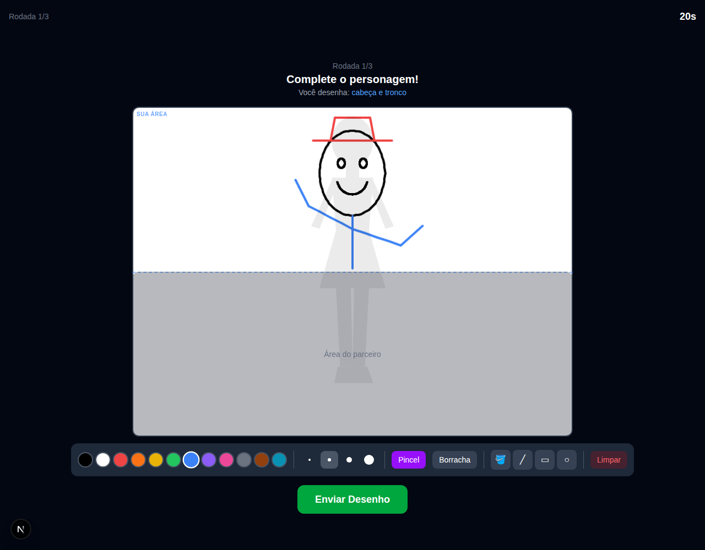

# Scrawl

A realtime multiplayer party drawing game: players share a canvas they can only half see, and the fun is in the reveal.

[](https://github.com/whaletalent/scrawl/actions/workflows/ci.yml)
[](https://github.com/whaletalent/scrawl/actions/workflows/deploy.yml)

**▶ Play it: https://whaletalent.github.io/scrawl/**



## What it is

Scrawl is a browser party game for friends on a call or in the same room. One player creates a room and shares the invite link; everybody else opens it, picks a nickname and joins. Nobody sees what their partner is drawing until the reveal. The interface is in Portuguese (pt-BR); this README is in English. It works on desktops, tablets and phones.

## Game modes

| Mode             | Players | How it works                                                                                                                                                                                                             |
| ---------------- | ------- | ------------------------------------------------------------------------------------------------------------------------------------------------------------------------------------------------------------------------ |
| **Party**        | 4–10    | Everyone writes absurd themes, pairs draw one theme on a split canvas (left/right) without seeing each other's half, then everybody ranks the results. With an odd number of players, one player per round is the judge. |
| **Split Body**   | 2       | One player draws the top half of a character, the other the bottom, over a faint silhouette. Sides alternate each round.                                                                                                 |
| **Face Builder** | 2       | Six face regions (hair, ears, eyes, nose, mouth, shoulders) are shuffled and split three and three; each player can only draw in their own regions.                                                                      |

## How it works

1. The web app is a static site. All it does is talk to the WebSocket server, which is the single source of truth for every room.
2. Rooms live in the server's memory: a room has a five-character code, a list of players and a phase. Restarting the server ends every game.
3. The server drives the game as a state machine (`lobby → theme-creation → drawing → voting → reveal → …`), broadcasting a `phase-change` with a deadline; clients only render the current phase and send their input.
4. Drawings are made on an 800×600 canvas clipped to the player's own area and sent as PNG data URLs when the player submits (or automatically just before the deadline).
5. A player whose connection drops, or who reloads the page, keeps their slot for 20 seconds and is put back into the running game when they return.

## Tech stack

| Library                                     | Why                                                         |
| ------------------------------------------- | ----------------------------------------------------------- |
| [Next.js 15](https://nextjs.org) + React 19 | The web app, built as a static export                       |
| [Tailwind CSS 4](https://tailwindcss.com)   | Styling                                                     |
| HTML5 Canvas                                | Drawing tools: brush, eraser, fill, line, rectangle, circle |
| [ws](https://github.com/websockets/ws)      | The WebSocket game server (Node.js)                         |
| TypeScript                                  | Both apps, strict mode                                      |
| `node:test` + [tsx](https://tsx.is)         | Server test suite, against the real server in-process       |
| [Playwright](https://playwright.dev)        | Browser test suite, with scripted bots as the other players |
| ESLint, Prettier                            | Linting and formatting                                      |
| GitHub Actions                              | CI, and deploy of the web app to GitHub Pages               |
| Docker                                      | Container image for the WebSocket server                    |

## Run locally

Requires Node 24 (see `.nvmrc`).

```bash
nvm use
npm ci
npm run dev
```

Then open <http://localhost:3000>. The web app runs on port 3000 and the WebSocket server on port 8080. To try it alone, open the invite link in extra browser tabs.

The web app finds the server through `NEXT_PUBLIC_WS_URL` (default `ws://localhost:8080`); set it in `apps/web/.env.local` to point somewhere else.

| Script                 | What it does                                             |
| ---------------------- | -------------------------------------------------------- |
| `npm run dev`          | Start the web app and the WebSocket server               |
| `npm run build`        | Static build of the web app into `apps/web/out/`         |
| `npm run build:server` | Compile the WebSocket server into `apps/ws-server/dist/` |
| `npm test`             | Server test suite (~10s)                                 |
| `npm run test:e2e`     | Browser test suite (~1.5min)                             |
| `npm run typecheck`    | Type-check both apps and the tests                       |
| `npm run lint`         | Lint with ESLint                                         |
| `npm run lint:fix`     | Lint and apply automatic fixes                           |
| `npm run format`       | Format with Prettier                                     |
| `npm run format:check` | Check formatting without writing                         |

## Tests

- **Server suite** (`apps/ws-server/test`): each file starts the real server in-process on a free port and plays against it with WebSocket clients, with game phases sped up. Covers room rules, voting, the odd-player rotation, the two-player modes, leaving, reconnection and input hardening.
- **Browser suite** (`e2e/`): Playwright drives the real app in Chromium while scripted bots play the other players over the WebSocket protocol. It starts its own servers (web on port 3100, WebSocket on port 8089), so it can run next to `npm run dev`. First time only: `npx playwright install chromium`.

To play a sped-up game by hand, start the WebSocket server with `PHASE_TIME_SCALE=0.2` (every phase five times shorter).

## Project structure

```
apps/
  web/                    Next.js app (static export)
    src/app/              landing page and the room page (/room/?code=ABCDE)
    src/components/       lobby, one component per game phase, canvas, share card
    src/hooks/            game state over the socket, canvas drawing, timer
    src/lib/              WebSocket client, routes, face region geometry
    src/types/            the message protocol, mirrored from the server
  ws-server/              WebSocket game server
    src/app.ts            HTTP + WebSocket server factory
    src/handlers.ts       message dispatch, disconnect grace period, rejoin
    src/game-engine.ts    phase state machine, pairing, scoring
    src/room-manager.ts   rooms and players
    src/config.ts         time scale and reconnect grace period
    test/                 server test suite
    Dockerfile
e2e/                      Playwright browser suite
docs/                     screenshot, design specs, implementation plans, mode ideas
.github/workflows/        ci.yml and deploy.yml
```

## CI & deploy

- **CI** (`ci.yml`) runs on every push and pull request: lint, format check, type-check, server tests, both builds, and the browser suite in a second job.
- **Deploy** (`deploy.yml`) runs on pushes to `main`: it builds the web app and publishes `apps/web/out/` to GitHub Pages. The address of the WebSocket server comes from the `WS_URL` repository variable (for example `wss://scrawl.example.com`).
- The **WebSocket server** needs a host that keeps a Node process running, which GitHub Pages can't do. It ships as a container:

  ```bash
  docker build -f apps/ws-server/Dockerfile -t scrawl-ws .
  docker run -p 8080:8080 scrawl-ws
  ```

  It listens on `PORT` (default 8080), answers plain HTTP with a 200 for health checks, and must be reachable over `wss://` for the Pages site to connect to it.

- Dependabot keeps npm packages, GitHub Actions and the Docker base image up to date.

## License

[MIT](LICENSE)
