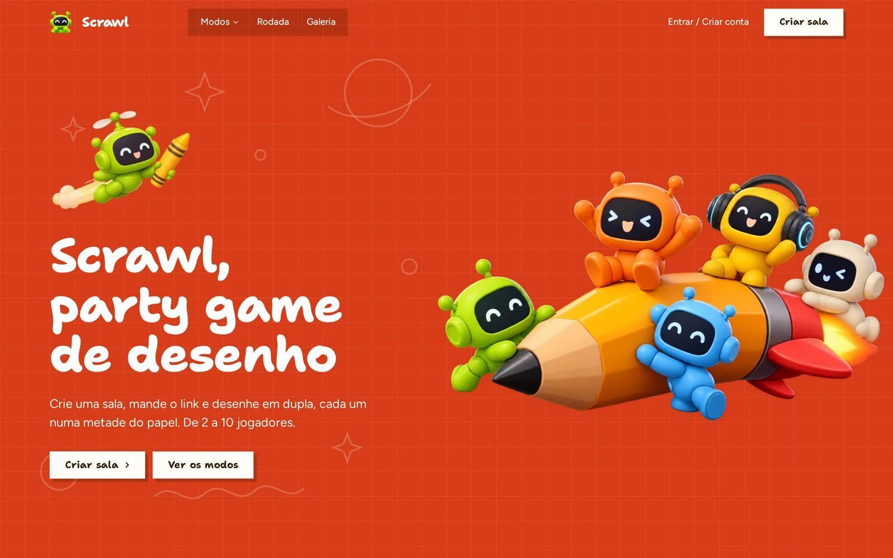
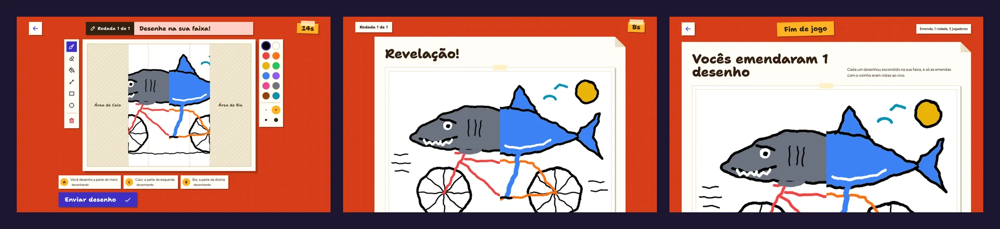

# Scrawl

A realtime multiplayer party drawing game: players share a canvas they can only partly see, and the fun is in the reveal.

[](https://github.com/whaletalent/scrawl/actions/workflows/ci.yml)
[](https://github.com/whaletalent/scrawl/actions/workflows/deploy.yml)

**▶ Play it: https://whaletalent.github.io/scrawl/**





## What it is

Scrawl is a browser party game for friends on a call or in the same room. One player creates a room and shares the invite link; everybody else opens it, picks a nickname and joins. Each player draws their own part of a shared picture without seeing the others' parts; in Racha-tema and Emenda, the narrow seam between two parts is drawn together, live. The whole picture only shows up at the reveal. The interface is in Portuguese (pt-BR); this README is in English. It works on desktops, tablets and phones.

## Game modes

| Mode (code id)                         | Players | How it works                                                                                                                                                                                                                                                                  |
| -------------------------------------- | ------- | ----------------------------------------------------------------------------------------------------------------------------------------------------------------------------------------------------------------------------------------------------------------------------- |
| **Racha-tema** (`party`)               | 4–10    | Everyone writes absurd themes; pairs draw one theme on a shared sheet, each on a hidden side, meeting in a middle strip they both see live. Then everybody ranks the results; the last round counts double. With an odd number of players, one player per round is the judge. |
| **Emenda** (`seam`)                    | 2–10    | No theme, no score: every round regroups the players into pairs (and one trio when the count is odd). Each draws a hidden strip of the sheet; only the seams with the neighbours are shared live. Each round ends with a reveal, and the game with every picture.             |
| **Monstrinho** (`split-body`)          | 2       | One player draws the top half of a character, the other the bottom, over a faint silhouette. Sides alternate each round.                                                                                                                                                      |
| **Caricatura a dois** (`face-builder`) | 2       | Six face regions (hair, ears, eyes, nose, mouth, shoulders) are shuffled and split three and three; each player can only draw in their own regions.                                                                                                                           |

## How it works

1. The web app is a static site. All it does is talk to the WebSocket server, which is the single source of truth for every room.
2. Rooms live in the server's memory: a room has a five-character code, a list of players and a phase. Restarting the server ends every game.
3. The server drives the game as a state machine (`lobby → theme-creation → drawing → voting → reveal → …`), broadcasting a `phase-change` with a deadline; clients only render the current phase and send their input.
4. Drawings are made on an 800×600 canvas clipped to the player's own area and sent as PNG data URLs when the player submits, or when the server says the time is up (the server waits a few seconds for them, so a slow phone doesn't lose its drawing).
5. **Live seams** (Racha-tema and Emenda): each player draws on a transparent layer of their own. While they draw, the browser sends a snapshot of its part of each shared strip (a 100-px band between two neighbours) up to 12 times a second; the server checks it and relays it only to the neighbour across that strip, never to anyone else, so a player's hidden part never leaves their browser before the reveal. The server keeps the latest snapshot, so a player who reconnects gets the seam back and nothing drawn there is lost from the final picture.
6. Accounts are optional. A player can sign up (e-mail and password, or Google), pick a username and draw their own avatar, which then shows next to their name in every room. Accounts live in a [Supabase](https://supabase.com) project; guests keep playing with just a nickname, and without a Supabase project the game simply has no login. A logged-in player lands on a home that lists the open **public rooms** (the creator chooses private or public), so they can join a stranger's game. At the end of a game a logged-in player can save a drawing to the public **gallery**; the home shows the latest ones and `/gallery/` shows them all.
7. A player whose connection drops, or who reloads the page, keeps their slot for 20 seconds and is put back into the running game when they return.

## Tech stack

| Library                                     | Why                                                         |
| ------------------------------------------- | ----------------------------------------------------------- |
| [Next.js 15](https://nextjs.org) + React 19 | The web app, built as a static export                       |
| [Tailwind CSS 4](https://tailwindcss.com)   | Styling                                                     |
| HTML5 Canvas                                | Drawing tools: brush, eraser, fill, line, rectangle, circle |
| [Phosphor Icons](https://phosphoricons.com) | Icons                                                       |
| [React Bits](https://reactbits.dev)         | The landing's drawing carousel and drifting gallery wall    |
| [ws](https://github.com/websockets/ws)      | The WebSocket game server (Node.js)                         |
| [Supabase](https://supabase.com)            | Optional accounts, profiles, avatars and the gallery        |
| TypeScript                                  | Both apps, strict mode                                      |
| `node:test` + [tsx](https://tsx.is)         | Server test suite, against the real server in-process       |
| [Playwright](https://playwright.dev)        | Browser test suite, with scripted bots as the other players |
| [sharp](https://sharp.pixelplumbing.com)    | The landing's pictures, made from real games                |
| ESLint, Prettier                            | Linting and formatting                                      |
| GitHub Actions                              | CI, and deploy of the web app to GitHub Pages               |
| Docker                                      | Container image for the WebSocket server                    |

## Run locally

Requires Node 24 (see `.nvmrc`).

```bash
nvm use
npm ci
npm run dev
```

Then open <http://localhost:3000>. The web app runs on port 3000 and the WebSocket server on port 8080. To try it alone, open the invite link in extra browser tabs.

The web app finds the server through `NEXT_PUBLIC_WS_URL` (default `ws://localhost:8080`); set it in `apps/web/.env.local` to point somewhere else.

| Script                 | What it does                                             |
| ---------------------- | -------------------------------------------------------- |
| `npm run dev`          | Start the web app and the WebSocket server               |
| `npm run build`        | Static build of the web app into `apps/web/out/`         |
| `npm run build:server` | Compile the WebSocket server into `apps/ws-server/dist/` |
| `npm test`             | Server and web unit suites (~10s)                        |
| `npm run test:e2e`     | Browser test suite (~3min)                               |
| `npm run typecheck`    | Type-check both apps and the tests                       |
| `npm run lint`         | Lint with ESLint                                         |
| `npm run lint:fix`     | Lint and apply automatic fixes                           |
| `npm run format`       | Format with Prettier                                     |
| `npm run format:check` | Check formatting without writing                         |

## Tests

- **Server suite** (`apps/ws-server/test`): each file starts the real server in-process on a free port and plays against it with WebSocket clients, with game phases sped up. Covers room rules, voting, the odd-player rotation, every mode, Emenda's grouping, who receives each live seam, leaving, reconnection, play-again, the gallery, input hardening and player identity (accounts).
- **Web unit tests** (`apps/web/test`): the pure parts of the canvas, such as the seam geometry, the fill bucket and the seam sender's rate limit.
- **Browser suite** (`e2e/`): Playwright drives the real app in Chromium while scripted bots play the other players over the WebSocket protocol. It starts its own servers (web on port 3100, WebSocket on port 8089, and a fake Supabase on port 8090 so the account and gallery flows run without a real project), so it can run next to `npm run dev`. One test uses two real pages to check that a partner sees the seam live and nothing else. First time only: `npx playwright install chromium`.

To play a sped-up game by hand, start the WebSocket server with `PHASE_TIME_SCALE=0.2` (every phase five times shorter).

## Project structure

```
apps/
  web/                    Next.js app (static export)
    src/app/              landing/home, room (/room/?code=ABCDE), login, welcome, profile, gallery
    src/components/       one component per game phase, canvas and seam canvas, lobby, home,
                          gallery, share card, landing page (on a vendored design kit in public/assets)
    src/hooks/            game state over the socket, canvas layers, seam sender, account
    src/lib/              WebSocket client, routes, seam and face geometry, picture compose, Supabase
    src/types/            the message protocol, mirrored from the server
  ws-server/              WebSocket game server
    src/app.ts            HTTP + WebSocket server factory
    src/handlers.ts       message dispatch, disconnect grace period, rejoin
    src/game-engine.ts    phase state machines, pairing and grouping, scoring
    src/strips.ts         live seams: checks, relay to the neighbour, kept frames
    src/gallery.ts        saving a finished drawing to the gallery
    src/room-manager.ts   rooms and players
    src/config.ts         time scale, reconnect and submit grace periods
    test/                 server test suite
    Dockerfile
e2e/                      Playwright browser suite
scripts/landing-art/      plays real games to make the landing's pictures, then composes them
supabase/migrations/      accounts, gallery and Emenda schema (run in order)
docs/                     README images, Supabase setup, design specs, plans, mode ideas
.github/workflows/        ci.yml, deploy.yml, supabase-keepalive.yml
```

## CI & deploy

- **CI** (`ci.yml`) runs on every push and pull request: lint, format check, type-check, server tests, both builds, and the browser suite in a second job.
- **Deploy** (`deploy.yml`) runs on pushes to `main`: it builds the web app and publishes `apps/web/out/` to GitHub Pages. The address of the WebSocket server comes from the `WS_URL` repository variable (for example `wss://scrawl.example.com`).
- The **WebSocket server** needs a host that keeps a Node process running, which GitHub Pages can't do. It ships as a container:

  ```bash
  docker build -f apps/ws-server/Dockerfile -t scrawl-ws .
  docker run -p 8080:8080 scrawl-ws
  ```

  It listens on `PORT` (default 8080), answers plain HTTP with a 200 for health checks, and must be reachable over `wss://` for the Pages site to connect to it.

  `render.yaml` is a [Render](https://render.com) Blueprint for it: in Render choose New > Blueprint and pick this repository, then put the service's address in the `WS_URL` repository variable (`wss://<name>.onrender.com`) and re-run the deploy workflow. Rooms live in memory, so run a single instance.

- **Accounts** are off until a Supabase project is connected: [`docs/supabase-setup.md`](docs/supabase-setup.md) has the steps, including the three migrations in `supabase/migrations/`. A scheduled workflow (`supabase-keepalive.yml`) reads one row a day so the free project isn't paused for inactivity.
- Dependabot keeps npm packages, GitHub Actions and the Docker base image up to date.

## License

[MIT](LICENSE)
